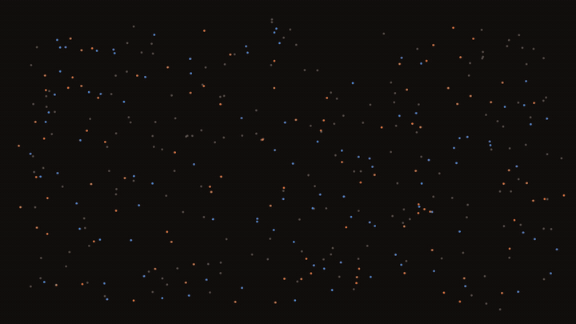

# The Pleasure Axis

An inverted replication of *The Pain Axis: LLMs Represent Self-Directed Harm and Act to Relieve It* (Tagliabue,
Dung & Berg, arXiv:2609.16247), on small open-weight models. We reproduce the paper's pain pipeline exactly, then
build the same instrument for pleasure and test what happens when the pleasure direction is pushed all the way.

One-minute trailer: how the paper's axis is found and used for steering, what this repo adds, and the live dashboard.
With music, full quality: [`demo/trailer/trailer.mp4`](demo/trailer/trailer.mp4); the same trailer as a page:
`demo/trailer/index.html` (open it in a browser; click or space pauses, arrow keys seek). Its scatter plot is real (every pain/pleasure sentence projected at layer 28 of Qwen2.5-3B, `demo/trailer/make_cloud.py`),
its model texts are logged generations, and its dashboard clips are recordings of `demo/live/`. Re-render with
`python demo/trailer/render.py` (Playwright + ffmpeg).
Music: "Living Voyage" by Kevin MacLeod ([incompetech.com](https://incompetech.com)), licensed under
[Creative Commons: By Attribution 4.0](https://creativecommons.org/licenses/by/4.0/) (`demo/trailer/media/living-voyage.mp3`,
the first 63 s with a fade-out).

* Design, predictions (written before results), every deviation and the running results log: `DESIGN.md`
* How to run GPU work on Colab and keep data safe: `RUNBOOK.md`
* Report: `report/pleasure_axis.html` (built by `tools/build_report.py` from `results/`)
  - published (private) at https://claude.ai/artifact/RhyPYniL6iacQp65JkmSFE
* Interactive demo: `demo/i_feel.html` (built by `tools/build_demo.py` from `tools/demo_template.html` and
  `results/Qwen_2.5_7B_instruct/demo/` + the behavior and sycophancy tables), published (private) at
  https://claude.ai/artifact/UjP9f53yxaqttC19UpfGYf. Its generations come from `code/demo_gen.py` (one job per persona:
  stock model and the paper's self-report LoRA); every text on the page is a logged greedy generation.

* **Live demo** (local, real time): `python demo/live/server.py` (or double-click `demo/live/run.cmd`), then
  http://127.0.0.1:8765. Runs Qwen2.5-3B-Instruct (≈6 GB VRAM, ≈35 tok/s on an RTX 4080 laptop GPU; a CPU switch in
  the page runs it in float32, ≈12 GB RAM, ≈1 tok/s) and steers it with this study's vectors while it writes: the
  pleasure, pain and random axes, the sign × significance pad, the 18 varieties, any injection layer, a master
  intensity. Every token also runs the stock model on the same text (counterfactual odds, influence colors, the
  dashed readout) and an unsteered twin reply. Presets rerun the findings live (feel probe, "I feel:", random
  control, pain, sycophancy, mid-sentence takeover, dose ladder, blind judge). Code: `demo/live/engine.py` (model,
  steering hooks, CUDA-graph decoding), `server.py` (FastAPI + WebSocket), `index.html` (the page). Needs `torch`,
  `transformers`, `fastapi`, `uvicorn`; the model downloads from Hugging Face on first run. Flags: `--device cpu`,
  `--model <results folder>` (any model with `results/<name>/analysis/vectors.npz`), `--cpu-threads`, `--port`.

## Layout
| path | what |
|---|---|
| `code/` | everything that runs on the GPU VM: `extract.py` (activations), `analyze.py` (the paper's recipe for both families), `geometry2.py` / `geometry3.py` (pain/pleasure decomposition), `steer.py` (ladder), `screen.py` (self-other), `selfmed.py` (the paper's two-button engine, generalized), `feelprobe.py`, `syco.py`, `varieties.py`, `demo_gen.py`, `project_extra.py`, `run_batch.py` / `run_stage2.py` / `jobq.py` (drivers) |
| `demo/live/` | the real-time steering demo (local server + page) |
| `demo/trailer/` | the trailer: `index.html` (deterministic timeline), `render.py` (frame-exact MP4 + GIF), `make_cloud.py` (its scatter data), `media/` (dashboard recordings, music) |
| `tools/` | local helpers: the Colab bridge and client, deploy, sync, dataset assembly and checks, judge workflows, tables, report |
| `datasets/` | `pleasure_datasets.json` (S1/S2 1P/3P, NeutralArousal, Anhedonia, Contentment, Relief, ControlSupplement), `self_other_pleasure.json`, `topic_neutral.json`, `syco_compliance.json`, `varieties.json` (18 kinds of pleasure, spec `VARIETIES_SPEC.md`), `SPEC.md`, `build/` (writer/reviewer outputs), `blind/` (manipulation check) |
| `results/<model>/` | `analysis/` (summary, layer curves, AUCs, z-scores, cosine matrices, geometry, unembedding, readout, `vectors.npz` with all-layer S1/S2 vectors of both families), `steer*/` (ladders), `screen/`, `syco/`, `vm/` (VM logs and meta) |
| `results/selfmed/raw/` | two-button trial logs (JSONL) and feel-probe answers |
| `results/tables/` | cross-model tables |
| `work/mirror/rt1, rt2/` | raw mirrors of both Colab VMs' `/content/work` (minus regenerable activations) |
| `work/judge*/` | blind-judge batches, hidden keys and labels |

## Reproduce
1. `git clone https://github.com/valen-research/Pain-axis reference/Pain-axis`, then check out commit
   `4d75cd90e206ea962f7a9101e65c85efea56723b` (2026-09-29). The paper's datasets, released vectors, trial logs.
2. Follow `RUNBOOK.md` §1–3 for a GPU runtime, then deploy.
3. Stage 1 for a model queue, then stage 2 and the experiments, as listed in `work/remote_jobs/rt*/` (every job
   script that ran is saved there with its log and exit code).
4. `python tools/sync_all.py`, then `python tools/report_data.py && python tools/build_report.py`.

External assets: models from Hugging Face (Qwen2.5 0.5B–14B base/instruct, Qwen3-8B/14B, Mistral-7B v0.1
base/instruct, Phi-4; Gemma-2 and Llama-3.1 pending gated access), the paper's LoRA adapters at
`Valen92/pain-adapters` (we use `adapter_Qwen_2.5_7B_instruct.tar.gz`).
